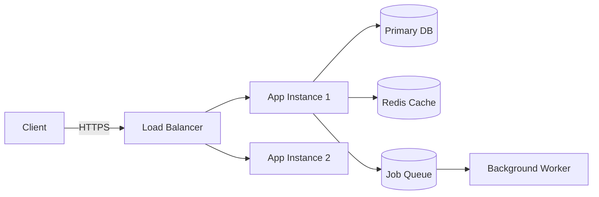

# 軟體工程系統架構規劃 (System Architecture)

**文件版本**: v1.0  
**更新日期**: 2026-02-04

---

## 1. 架構設計視圖 (High-Level Architecture)

本系統採用 **模組化單體 (Modular Monolith)** 架構，在保持開發敏捷性的同時，預留未來微服務拆分的彈性。

### 1.1 系統環境與邊界 (Context View)

```mermaid
graph TD
    User[店鋪人員/管理員] -->|HTTPS/Web/App| POS_System[StallEasy POS 核心系統]
    
    POS_System -->|API| LINE_Pay[LINE Pay 金流平台]
    POS_System -->|API/Turnkey| E_Invoice[財政部電子發票平台]
    POS_System -->|SMTP| Email_Service[邮件通知服務]
    POS_System -->|Webhook| Delivery[外送平台整合 (Foodpanda/UberEats)]
```

---

## 2. 應用程式架構 (Application Architecture)

後端採用標準的分層架構 (Layered Architecture)，確保關注點分離 (Separation of Concerns)。

### 2.1 分層設計

1.  **介面層 (Presentation Layer / API)**
    - 負責處理 HTTP 請求、路由分派、請求驗證 (Pydantic)、回應格式化。
    - 不包含任何複雜業務邏輯。
    - Location: `app/api/`

2.  **業務邏輯層 (Business Logic Layer / Service)**
    - 系統核心，實作所有業務規則 (如：折扣計算、庫存扣減、訂單狀態流轉)。
    - 跨模組的協作調度。
    - Location: `app/services/`

3.  **資料存取層 (Data Access Layer / Repository)**
    - 負責與資料庫互動，封裝 CRUD 操作。
    - 隔離 SQL 或 ORM 實作細節，方便未來更換資料庫技術。
    - Location: `app/crud/` 或 `app/repositories/`

4.  **基礎設施層 (Infrastructure Layer)**
    - 第三方服務整合 (LINE Pay, Email)、Log、Cache。
    - Location: `app/core/`, `app/utils/`

### 2.2 模組劃分 (Modules)
系統依業務領域劃分為獨立模組，模組間盡量降低耦合 (Low Coupling)。

- `users`: 帳號、權限、認證。
- `stores`: 店鋪基本資料、設定。
- `products`: 商品、分類、選配項 (Modifiers)。
- `orders`: 訂單交易、購物車、狀態機。
- `payments`: 金流交易紀錄、對帳。
- `invoices`: 電子發票開立、作廢、折讓。
- `reports`: 報表統計、數據聚合。

---

## 3. 資料架構 (Data Architecture)

### 3.1 資料庫選型
- **Primary DB**: **PostgreSQL 14+**
  - 使用 JSONB 儲存彈性資料 (如：商品屬性 snapshot，保留歷史交易當下的商品狀態)。
  - 使用 Transaction (ACID) 確保帳務一致性。

### 3.2 資料流向 (Data Flow)
**訂單建立流程範例**:
1.  **API**: 接收 `POST /orders`，驗證資料格式。
2.  **Service**: 
    - 檢查商品庫存。
    - 計算總金額與折扣。
    - 呼叫 `PaymentService` 初始化付款。
3.  **Repository**: 在 Transaction 中寫入 `orders`, `order_items` 資料表，並扣減 `products` 庫存。
4.  **Event**: 交易成功後，發送 `OrderCreated` 事件 (非同步處理發票開立、通知)。

---

## 4. 部署架構 (Deployment Architecture)

採用容器化部署，確保環境一致性。

### 4.1 容器化
- **Docker**: 應用程式封裝為 Docker Image。
- **Docker Compose**: 本地開發環境編排 (App + DB + Redis)。

### 4.2 雲端/地端配置 (Cloud/On-Premise)
- **Load Balancer**: Nginx 或雲端 LB，負責 SSL Termination。
- **App Server**: FastAPI (Uvicorn/Gunicorn)，可水平擴展 (Scale-out)。
- **Task Queue**: Redis + Worker (處理耗時任務，如報表生成)。
- **Database**: Managed PostgreSQL (建議) 或自建高可用叢集。


